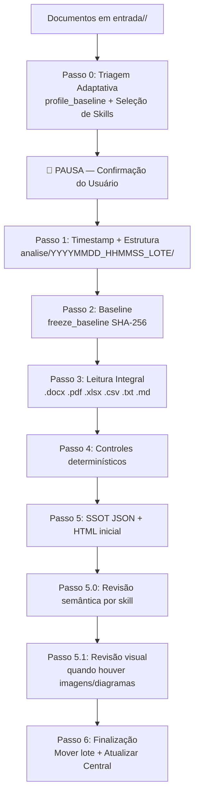

# Framework Corporativo de Revisão Técnica Independente (FCA-ENG-001)

[](framework/revisao.md)
[](framework/revisao.md)

O **FCA-ENG-001** é um framework padronizado para condução de **Revisão Técnica Independente (RTI)** sobre documentações de engenharia, RFPs, RFIs, HLDs, LLDs, planilhas de especificação, arquitetura de sistemas e contratos de TI/Telecom/Cloud.

---

## 📌 Princípios

1. **Revisão, não consultoria:** O revisor constata fatos, aponta lacunas e evidencia riscos; não inventa requisitos, dimensionamentos, SLAs ou arquitetura.
2. **Evidência antes de conclusão:** Toda constatação exige citação de trecho ou hash SHA-256 congelado.
3. **Segregação tridimensional:** Tipo do achado × Criticidade × Prioridade são campos independentes e nunca sinônimos.
4. **Sem atos oficiais:** Minutas sugeridas são não oficiais — condicionadas à validação do proprietário competente.
5. **PT-BR exclusivo:** 100% dos relatórios, análises e comunicações em Português do Brasil.
6. **6 relatórios reais:** Nenhum arquivo é cópia de outro. IQD calculado dinamicamente.
7. **Correlação cruzada:** Todos os arquivos de um lote são comparados entre si.

---

## 🗺️ Fluxo do Processo RTI



---

## 📂 Estrutura do Repositório

```text
.
├── .agents/
│   ├── AGENTS.md                        # Diretrizes globais para assistentes de IA
│   └── skills/
│       ├── analisar-documento/          # Skill base — orquestra a RTI completa
│       ├── analisar-rfp/                # Análise especializada de RFPs e RFIs
│       ├── analisar-hld/                # Análise de High Level Designs
│       ├── analisar-lld/                # Análise de Low Level Designs
│       ├── analisar-contrato/           # Análise de cláusulas contratuais e SLAs
│       ├── analisar-planilha/           # Análise de planilhas .xlsx e .csv
│       ├── analisar-diagramas/          # Análise multimodal de imagens/diagramas
│       └── analisar-lgpd/              # Conformidade LGPD
├── mcp-server/
    │   ├── server.py                        # Servidor MCP: extração, controles e persistência auditável
    │   ├── semantic_pipeline.py             # Contrato de evidência e escopos da revisão semântica
│   ├── audit_engine.py                  # Gerador dos 6 relatórios Markdown
│   ├── html_compiler.py                 # Compilador HTML corporativo
│   └── requirements.txt                 # openpyxl, pypdf
├── framework/
│   ├── revisao.md                       # Procedimento FCA-ENG-001
│   ├── checklists/                      # 23 checklists por domínio
│   ├── templates/                       # Templates de achados, saída e HTML
│   └── normas/                          # Catálogo normativo
├── entrada/                             # Lotes para análise (subpastas numeradas)
│   └── lote-exemplo-rfp/
│       ├── 00_RFP_Principal.docx
│       ├── 01_Anexo_A_Requisitos.docx
│       └── planilha_quantitativos.xlsx
└── analise/                             # Histórico de análises por timestamp
    ├── index.html                        # Central Master de Análises
    ├── manifest.json
    └── YYYYMMDD_HHMMSS_NOME_LOTE/
        ├── entrada/                      # Cópia dos arquivos originais (imutável)
        └── relatorios/
            ├── 00_RESUMO_EXECUTIVO.md
            ├── 01_PONTOS_DE_ATENCAO.md
            ├── 02_ACOES_E_MINUTAS.md
            ├── 03_RASTREABILIDADE_E_LOG.md
            ├── 04_LACUNAS_E_RISCOS.md
            ├── 05_CONFORMIDADE_CHECKLISTS.md
            └── index.html
```

---

## 📁 Estrutura de Entrada (Lotes)

Cada subpasta numerada em `entrada/` é um **lote de análise independente**:

```text
entrada/
  lote-exemplo-rfp/          ← Lote 1: analisado como conjunto coeso
    documento_principal.docx
    anexo_requisitos.docx
  lote-exemplo-hld/          ← Lote 2: analisado independentemente
    documento_hld.pdf
  lote-exemplo-planilha/     ← Lote com especificação e planilha
    especificacao_tecnica.docx
    quantitativos.xlsx
```

**Formatos suportados:** `.docx`, `.pdf`, `.xlsx`, `.csv`, `.txt`, `.md`, `.json`, `.yaml`, `.png`, `.jpg`, `.svg`

---

## 🤖 Como Executar (com IA)

### Prompt de Início Recomendado

> *"Execute a Revisão Técnica Independente do lote `lote-exemplo-rfp` em `entrada/` aplicando o procedimento FCA-ENG-001 (`framework/revisao.md`).  
> 1. Execute `profile_baseline` para identificar domínios, checklists e skills recomendadas.  
> 2. Apresente o plano de triagem e aguarde minha confirmação.  
> 3. Após confirmação: gere o timestamp, calcule os hashes SHA-256 e execute a análise completa.  
> 4. Gere os 6 relatórios em `analise/<timestamp>/relatorios/` e o `index.html`.  
> 5. Execute `finalize_execution` para arquivar o lote e atualizar a Central."*

### 🛠️ Skills Especializadas

| Skill | Gatilho |
|-------|---------|
| `analisar-documento` | Obrigatória para qualquer lote |
| `analisar-rfp` | RFP, RFI, Edital, Anexos |
| `analisar-hld` | HLD, NTP, Arquitetura |
| `analisar-lld` | LLD, ET, Especificação Técnica |
| `analisar-contrato` | Minuta de Contrato, Cláusulas, SLAs |
| `analisar-planilha` | `.xlsx`, `.csv` |
| `analisar-diagramas` | `.png`, `.jpg`, `.svg` |
| `analisar-lgpd` | LGPD, dados pessoais, privacidade |

---

## 📊 Relatórios de Saída (JSON SSOT + Central Executiva HTML)

| Arquivo | Conteúdo / Função |
|---------|-------------------|
| `dados_analise.json` | Base de dados estruturada SSOT contendo metadata, KPIs, Fichas 360°, Erratas, Planos de Ação (`ACT-00X`), Perguntas Formais (`Q-00X`), Lacunas, Riscos, Checklists e Hashes SHA-256 |
| `index.html` | Dashboard interativo corporativo consolidado com as 8 seções de análise, busca em tempo real, filtros e exportação PDF |

> **IQD** é calculado dinamicamente somente após a adjudicação dos achados confirmados; enquanto houver itens pendentes, exibe `—` para não sugerir uma conclusão prematura. Nenhum valor é hardcoded. A camada semântica é executada pelo modelo chamador; o MCP não faz chamada a um provedor de IA.

---

## 🔌 Servidor MCP

```json
{
  "mcpServers": {
    "fca-eng-001-rti": {
      "command": "python3",
      "args": ["/caminho/para/framework/mcp-server/server.py"]
    }
  }
}
```

**Ferramentas expostas:**
- `profile_baseline` — triagem semântica adaptativa
- `freeze_baseline` — hashes SHA-256 por lote
- `extract_docx_summary` — estrutura de .docx
- `extract_xlsx_summary` — abas e dados de .xlsx
- `validate_analise_contract` — verifica a presença de `index.html` e `dados_analise.json` e a cobertura das skills recomendadas
- `finalize_execution` — arquiva o lote e atualiza a Central
- `build_master_index` — recompila `analise/index.html`
- `get_semantic_review_manifest` / `get_semantic_document_chunk` / `record_semantic_analysis` — planejam e registram revisões especializadas com citações verificadas
- `adjudicate_findings` — confirma, exclui por falso positivo/escopo/duplicidade ou mantém pendente com trilha de auditoria
- `scaffold_skill` — cria rascunho de nova skill

---

## 🔒 Segurança

- `analise/*` e `entrada/*` são ignorados pelo `.gitignore` — nunca publicados.
- Nenhum valor de credencial deve constar nos documentos analisados.
